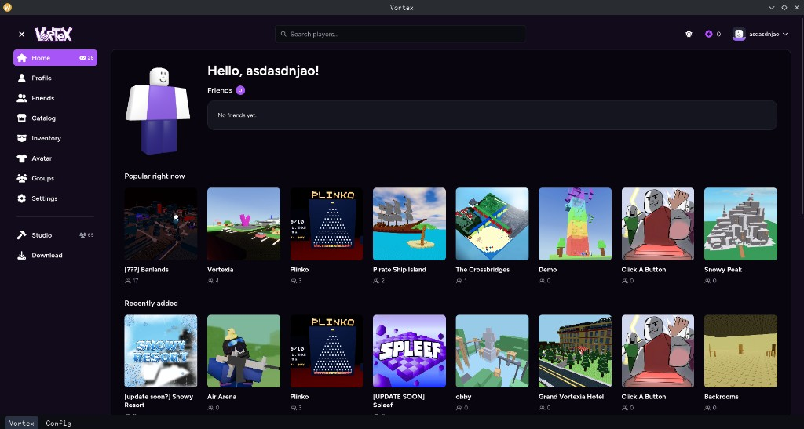

# Vortex Launcher

Launcher Linux para o [Vortex](https://playvortex.io). Abre o site numa janela e roda o cliente e o Studio com Wine.



## Instalação

```bash
curl -fsSL https://raw.githubusercontent.com/rafaelmarquesmatos/vortex-launcher/main/install.sh | bash
```

O comando baixa a última release Linux e abre pelo menu de aplicações. Para atualizar, roda o mesmo comando outra vez.

Wine, cliente e Studio ficam em `~/.local/share/vortex-launcher`. Quem roda a partir do código deste repositório continua a usar a pasta `linux/`.

## O que faz

- Mostra o site em [https://playvortex.io](https://playvortex.io).
- Baixa e atualiza o cliente e o Studio, cada um com o seu prefixo Wine.
- Na primeira abertura, baixa e extrai o Wine antes de mostrar o site.
- Instala o DXVK no prefixo na primeira vez que um jogo ou o Studio abre.
- A barra de baixo troca entre o site e a Config.


## Requisitos

Para abrir o launcher:

- Linux
- WebKitGTK 4.1 (`libwebkit2gtk-4.1`). O `install.sh` para se a biblioteca não estiver no sistema.
- `tar` e `sha256sum`

O pacote `gamemode` é opcional. Sem o binário `gamemoderun`, o jogo abre na mesma.

## Desenvolvimento

Precisa de [Bun](https://bun.sh), Rust stable e as dependências de sistema do [Tauri](https://v2.tauri.app/start/prerequisites/).

```bash
cd linux
bun install
bun run dev
```

A primeira execução baixa o Wine (cerca de 100 MB) se a pasta `linux/wine` ainda não existir.

## Build

```bash
cd linux
bun install
bun run build
```


## Config

A página Config guarda as opções em `settings.json`, na pasta de dados. Quem roda a partir do código usa `linux/`. A cópia instalada usa `~/.local/share/vortex-launcher`. O arquivo fica só na sua máquina.


| Grupo       | Opções                                                                                         |
| ----------- | ---------------------------------------------------------------------------------------------- |
| Launcher    | Fechar ao abrir uma instância, fechar ao abrir o Studio, voltar ao launcher ao sair da partida |
| Gráficos    | Vulkan, DXVK                                                                                   |
| Wine        | Esync, Fsync, GameMode                                                                         |
| Atualização | Versão instalada. Ao abrir, procura uma release mais nova                                      |
| Discord     | Client ID. Vazio, a presença fica desligada. Preenchido, o Discord mostra Vortex Launcher      |


## Atualização

Ao abrir, o launcher pede a última release de [rafaelmarquesmatos/vortex-launcher](https://github.com/rafaelmarquesmatos/vortex-launcher/releases).

Se a tag for mais nova e houver um asset com `linux` no nome (`.AppImage` ou `.tar.gz`), o arquivo vai para `update/` na mesma pasta de dados. Sem release, ou com tag igual, não mostra nada.